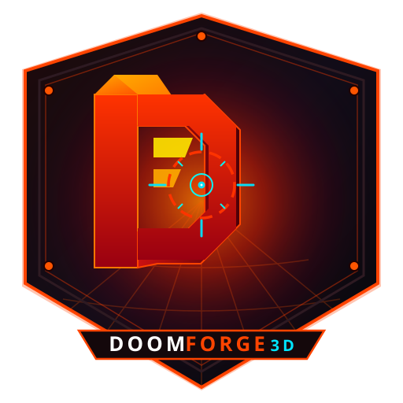

# DoomForge 3D 🔥

<div align="center">
  
  <h1>DoomForge 3D</h1>
  <p><strong>A 3D level designer, world builder, and retro FPS engine editor for Doom, Doom 2, and retro shooters.</strong></p>

  <p>
    <a href="LICENSE"></a>
    <a href="https://github.com/ZelTroN-2k3/DoomForge-3D"></a>
    
    
    
  </p>
</div>

---

## ⚡ Présentation

**DoomForge 3D** transforme la puissance d'un éditeur CAO 3D moderne en un atelier complet de création de niveaux et de mondes pour les jeux de tir rétro style **Doom / Doom II**.

Concevez des salles, des couloirs et des dénivellements complexes grâce aux outils de modélisation volumique CSG, importez directement vos fichiers `.wad` ou `.pk3`, placez des monstres, des armes et des barils explosifs, puis lancez immédiatement le **Playtest FPS** intégré pour tester votre niveau avec collisions réelles, sons procéduraux et arsenal d'époque.

---

## 🌟 Fonctionnalités clés

### 🎮 Mode Playtest FPS Intégré
- **Caméra première personne** : Navigation fluide clavier/souris (ZQSD ou WASD, saut avec Espace, vue 360° via Pointer Lock).
- **Moteur de collision AABB** : Détection des obstacles, murs solides, marches et sol en temps réel.
- **HUD rétro authentique** : Barre de statut avec munitions, points de vie %, portrait Mugshot réactif, armure % et sélection d'armes (Pistol / Shotgun).
- **Armes 2.5D animées** : Recul, flamme de tir (muzzle flash) et basculement dynamique.
- **Radar tactique / Minimap** : Vue satellite en temps réel avec position du joueur et des ennemis.
- **Synthétiseur audio procédural** : Bruitages rétro générés à la volée via la Web Audio API (détonations de fusil, rechargement, cris de monstres, ramassage d'items, explosions).

### 📂 Import WAD & PK3
- **Fichiers `.wad` natifs** : Prise en charge des IWADs et PWADs originaux (Doom 1, Doom 2, extensions classiques).
- **Format UDMF (`TEXTMAP`)** : Support des cartes modernes au format texte.
- **Archives `.pk3`** : Extraction et lecture automatique des cartes zippées GZDoom.
- **Conversion géométrique 3D automatique** :
  - **Murs 1-face** : transformés en boîtes de collision solides.
  - **Linedefs 2-faces** : transformés en marches de sol et linteaux de portes.
  - **Secteurs** : convertis en dalles de sol 3D élévatrices.
  - **Things** : convertis en entités 3D interactives (Player Start, monstres, fusil, items).

### 👾 Catalogue d'entités Retro FPS
- **Spawn** : *Player Start* avec orientation 3D.
- **Monstres** : *Imp* (pyramide hérissée hostile), *Demon Pinky* (colosse rouge de corps à corps).
- **Armes** : *Shotgun* à cartouches ramassable.
- **Pickups** : *Medikit* (+25 PV), *Green Armor* (+50 Armure), *Ammo Box* (+10 cartouches).
- **Props destructibles & interactifs** : *Barils explosifs toxiques*, *Colonnes lumineuses Tech*, *Clés d'accès* (Bleue, Rouge, Jaune).

### 🧱 Outils de modélisation 3D
- Primitives géométriques : boîtes, cylindres, cônes, escaliers, pyramides, cales.
- Opérations booléennes (Union, Soustraction / Trous, Intersection).
- Chanfreins et congés d'arêtes.
- Exportation multiple : manifestes de cartes JSON (`map.json`), jeu HTML autonome jouable hors-ligne, formats 3D (`OBJ`, `STL`, `3MF`, `STEP`).

---

## 🚀 Démarrage rapide

### Prérequis
- [Node.js](https://nodejs.org/) v24 ou supérieure
- [Git](https://git-scm.com/)

### Installation & Lancement

```bash
# 1. Cloner le dépôt
git clone https://github.com/ZelTroN-2k3/DoomForge-3D.git
cd DoomForge-3D

# 2. Installer les dépendances
npm install

# 3. Lancer le serveur de développement
npm run dev
```

Ouvrez ensuite votre navigateur sur **`http://localhost:3000`**.

---

## 📦 Scripts disponibles

- `npm run dev` : Démarre le serveur local de développement Next.js.
- `npm run build` : Compile le projet pour la production.
- `npm run typecheck` : Vérifie la cohérence des types TypeScript.
- `npm test` : Lance la suite de tests unitaires (dont le banc d'essai WAD/PK3).
- `npm run export` : Génère l'export statique autonome.

---

## 📜 Licence

Ce projet est distribué sous licence **GNU AGPLv3**.
Consultez le fichier [LICENSE](LICENSE) pour plus de détails.
